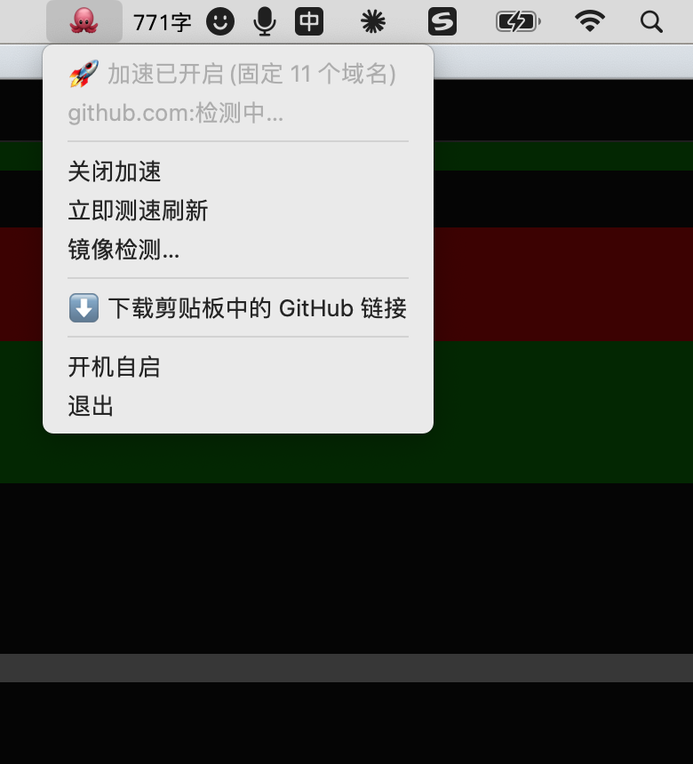
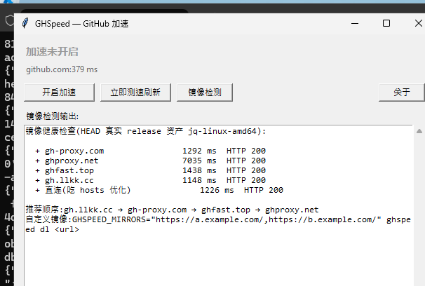

# GHSpeed 🐙

GitHub 加速工具:测速固定最快 IP + 镜像加速下载,只解决 GitHub 的问题,不碰其他任何网络。

| 平台 | 界面 | 最低要求 |
|---|---|---|
| macOS | 菜单栏 🐙 | 10.13+ |
| Windows | 安装包 / 便携版(tkinter 窗口)+ 命令行 | Windows 10+(运行时内置,无需装 Python) |
| Linux(Debian 系) | 命令行(无 UI) | Python 3,systemd |

## 截图

| 菜单栏 | 展开的菜单 | 应用图标 |
|:---:|:---:|:---:|
|  |  |  |

**Windows 10+ 简易界面(tkinter,真机截图):**



## 它解决什么

1. **加快访问 github** — 并发探测已知 GitHub 网段 + DoH 解析结果,按域名做 TLS 握手测速(证书验证防污染 IP),把最快 IP 写入 hosts 标记块,并装定时任务每 30 分钟自动重测换优
2. **加速 GitHub 下载** — ghproxy 系镜像回退链 + 直连兜底,停滞/低速自动换通道,支持 Range 断点续传
3. **打不开变能打开** — 链路在好坏窗口间摆动(TCP 通、TLS 间歇被丢)时,测速器跨窗口多轮重试,好窗口一到就把 IP 钉住

三平台同一份 Python 引擎(`ghspeed.py`),hosts / 定时刷新 / DNS 缓存 / 提权方式按平台自动适配(launchd / systemd / 计划任务)。

## 安装

从 [Releases](../../releases) 按平台下载对应包:

### macOS 10.13+

**方式一:`.pkg` 安装包(推荐,双击即装)**

1. 双击 `GHSpeed-macos-*.pkg` → 继续 → 安装,输入一次管理员密码
   (自动装好「应用程序」里的 GHSpeed 和命令行 `ghspeed`)
2. 浏览器下载的 pkg 带隔离属性,双击若被 Gatekeeper 拦截,任选其一:
   - 终端执行 `xattr -d com.apple.quarantine ~/Downloads/GHSpeed-macos-*.pkg` 后重新双击
   - 系统设置 → 隐私与安全性 → 点「仍要打开」
   (应用未做 Apple 公证;pkg 装出来的 App 没有隔离属性,可直接打开)
3. 点菜单栏 🐙 → 「开启加速」

**方式二:zip 免安装**

1. 解压 `GHSpeed-macos-*.zip`,把 `GHSpeed.app` 拖进「应用程序」
2. 首次打开:右键点击 → 「打开」(ad-hoc 签名,绕过 Gatekeeper)
3. 点菜单栏 🐙 → 「开启加速」,输入一次管理员密码,完成

只想用命令行的话:

```bash
git clone https://github.com/archerzing-tech/ghspeed.git
cd ghspeed && sudo ./install.sh && sudo ghspeed on
```

### Windows 10+

**方式一:安装包(推荐,双击即装,内置运行时免装 Python)**

1. 下载 `GHSpeed-windows-setup-*.exe` 双击安装(可选桌面快捷方式、加入 PATH)
2. 未做代码签名:SmartScreen 若拦截,点「更多信息」→「仍要运行」
3. 打开 GHSpeed → 「开启加速」→ UAC 弹窗选「是」,完成
4. 关闭窗口=最小化到任务栏托盘 🐙(双击托盘图标回到窗口,右键托盘菜单可退出)
   (卸载前建议以管理员运行 `ghspeed off` 还原 hosts 与计划任务,卸载器结束时会再提醒)

**方式二:便携 zip**

解压 `GHSpeed-windows-*.zip`,双击 `GHSpeed.exe`(运行时已内置,同样免装 Python)。
注意:小写的 `ghspeed.exe` 是命令行版,双击只弹一个黑窗(打印帮助后按回车退出);图形界面请认准大写 `GHSpeed.exe`。

**方式三:源码运行**(已有 Python 3 环境时)

双击 `ghspeed_gui.pyw`,或命令行 `python ghspeed.py on` / `off` / `status` / 双击 `ghspeed.bat`。

### Linux / Debian(命令行,无 UI)

```bash
sudo dpkg -i ghspeed_*_all.deb   # 或 apt install ./ghspeed_*_all.deb
sudo ghspeed on                  # 测速 + 固定 hosts + 装 systemd 定时器
sudo ghspeed off                 # 完全还原
```

依赖仅 `python3`;开启后自动安装 `ghspeed-refresh.timer`(每 30 分钟重测),`off` 时移除。

## 使用

### macOS 菜单栏

点 🐙:

| 菜单项 | 说明 |
|---|---|
| 状态行 | 加速开关状态、固定域名数、github.com 实测延迟(5 分钟自动刷新) |
| 开启加速 / 关闭加速 | 核心开关;关闭完全还原 hosts 与定时任务 |
| 立即测速刷新 | 手动重测一遍最优 IP |
| 镜像检测… | 并发探测各镜像健康度与延迟 |
| ⬇️ 下载剪贴板中的 GitHub 链接 | 复制链接 → 点一下,图标显示 `⬇️ xx%`,完成后弹通知,文件落在「下载」 |
| 开机自启 | 用户级 LaunchAgent,无需管理员 |
| 关于 GHSpeed | 显示版本号与项目地址 |

**启动即测**:应用一启动就在后台先跑一轮测速(用户权限,不写 hosts、不弹密码),结果存入种子缓存——之后点「开启加速」或「立即测速刷新」大多直接走种子轮,几秒完成。若当时已开启加速且配好了免密授权,启动测完还会自动把更优 IP 应用上,无需任何点击;检测到链路波动(已开启但不通)也会自动重测自愈。

### Windows 简易界面

双击 `GHSpeed_gui.pyw` 打开,按钮与 macOS 菜单一一对应:开启/关闭加速、立即测速刷新、镜像检测(结果直接显示在窗口里)、关于(版本号)。开启加速时弹 UAC 授权,提权后自动把开启做完。窗口关闭时最小化到系统托盘(装了 `pystray` 时),右键托盘图标退出。

### 命令行(三平台通用)

```
ghspeed on | off          开启/关闭(还原 hosts 与定时任务)
ghspeed status            查看固定 IP、延迟、守护状态
ghspeed probe             手动测速(不写 hosts)
ghspeed mirrors           镜像健康检查
ghspeed refresh           重测并更新 hosts(root / 管理员)
ghspeed dl <url> [-o 路径] [--direct] [--min-speed KB/s]
ghspeed git on | off      git clone 走镜像(push 前记得 off)
ghspeed --version         版本号
```

自定义镜像列表:

```bash
GHSPEED_MIRRORS="https://your-mirror.example.com/" ghspeed dl <url>
```

## 工作原理

```
┌─ 平台壳 ────────────────────────────────────┐
│  macOS:GHSpeed.app(菜单栏 🐙)              │
│  Windows:ghspeed_gui.pyw(tkinter 窗口)    │
│  Linux:无(直接用命令行)                    │
└──────────────┬──────────────────────────────┘
               │ 调用(同一份引擎)
┌─ CLI 引擎 ───▼──────────────────────────────┐
│  ghspeed.py(纯标准库 Python 3,三平台通用) │
│  · DoH + 静态网段候选 IP                     │
│  · 并发 TLS 握手测速(SNI 验证书)            │
│  · 最快 IP → hosts 标记块                    │
│  · 定时重测:launchd / systemd / 计划任务    │
│  · 下载:镜像回退链+断点续传+停滞跳道        │
└─────────────────────────────────────────────┘
```

只动这些 GitHub 域名:`github.com`、`api`、`codeload`、`*.githubusercontent.com` 等 13 个;不改系统代理、不改 DNS 服务器、其他网站一概不处理,`off` 后零残留。

## 已知限制

- `raw.githubusercontent.com` 与 `gist.github.com` 在部分网络受 SNI 级阻断(与 IP 无关),hosts 钉不住浏览器访问——这两个域的资源走镜像下载(`ghspeed dl` / 菜单下载)即可
- 直连链路整段 TLS 被丢时(「坏窗口」,几分钟一变),github.com 可能暂时连不上——这是网络本身在摆动,不是加速失效。refresh 会保留旧钉不回退,macOS 菜单栏检测到波动还会自动重测(免密时);窗口一开就恢复
- 镜像列表内置 4 个公共 ghproxy 系镜像,失效时用 `GHSPEED_MIRRORS` 自行替换

## 构建

```bash
./make_pkg.sh        # macOS:dist/GHSpeed-macos-*.pkg + GHSpeed.app(需 Xcode CLT 的 swiftc)
```

Linux `.deb` 与 Windows `.zip` 由 CI(打 `v*` 标签)构建,脚本见 `.github/workflows/release.yml`;Windows 界面为标准库 tkinter,无需额外依赖。

App 自包含 `ghspeed.py` 引擎;三平台共用同一引擎文件。

## License

[MIT](LICENSE)
